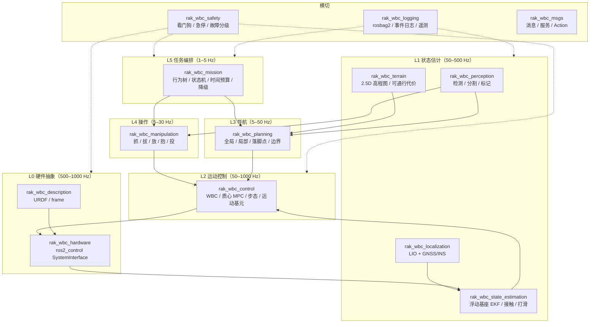
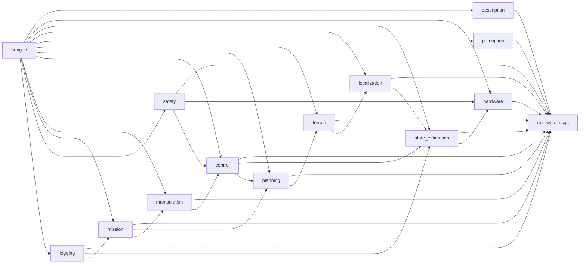
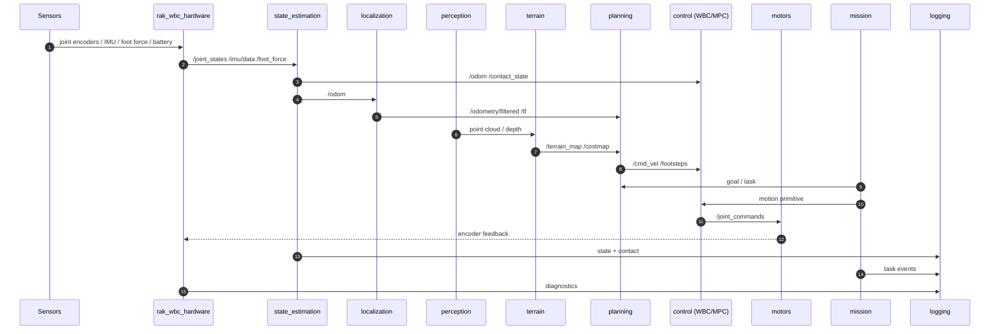
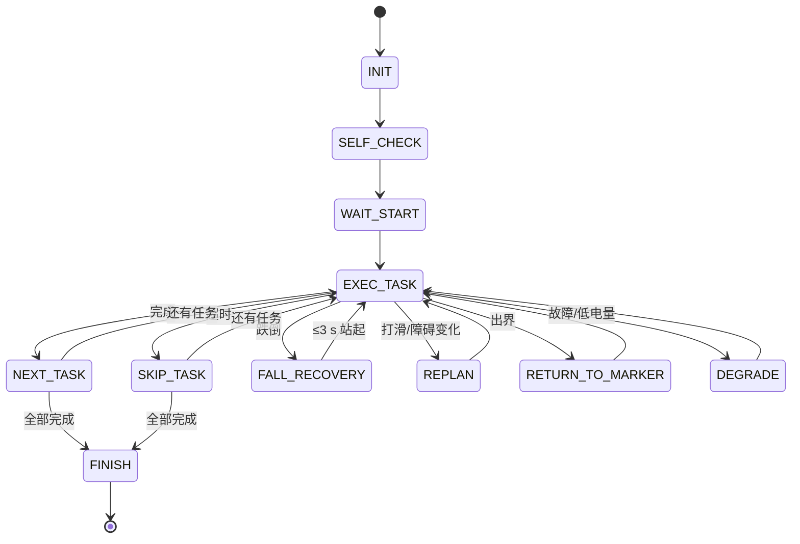

# rak-wbc 系统架构（v0.1 骨架）

> 本文是**仓库级**架构：包怎么分、谁依赖谁、数据怎么流、接口怎么定、实时性怎么保证。
> 赛题条款的逐条解读见 [`../03-软件架构方案.md`](../03-软件架构方案.md)；
> 全身姿态与无 sim2real 控制路线见 [`../技术攻关/05-全身姿态控制与无sim2real开源栈.md`](../技术攻关/05-全身姿态控制与无sim2real开源栈.md)。

---

## 1. 设计约束

| # | 约束 | 来源 | 架构后果 |
|---|---|---|---|
| 1 | 全自主，出发后禁止实时遥控 | 第三章 2.1 / 5.4 | 所有决策必须机载；状态机不允许 `GIVE_UP` |
| 2 | 禁止场外传图/下发指令 | 2.1.5 | 不能用云端 VLA；感知/规划/控制全部上机 |
| 3 | 轨迹数据实时回传裁判 | 1.3.4 | 独立遥测链路，与控制流解耦 |
| 4 | 越野颠簸/打滑下保持 ZMP 稳定 | 第三章 3 | 足底力 + 接触估计 + WBC 是核心 |
| 5 | 跌倒后 ≤3 s 自恢复 | 5.3 | 独立 FSM + 运动基元，不能被感知阻塞 |
| 6 | 全程日志留存 | 7.2 | rosbag2 + 结构化事件日志，掉电不丢 |
| 7 | 机载算力有限 | 2.1.5 | 控制环 C++/RT；感知/任务 Python 非实时 |
| 8 | 不训练 RL / 不做 sim2real | 本项目决策 | 模型基 WBC + 离线轨迹优化 + 在线辨识 |

---

## 2. 分层架构



### 2.1 频率解耦原则

| 层 | 频率 | 运行域 | 说明 |
|---|---|---|---|
| L0 硬件 | 500–1000 Hz | RT 核 | 读编码器/IMU/足底力，写关节命令 |
| L1 状态估计 | 200–500 Hz | RT 核 | IMU + 腿运动学 + 足底力 |
| L2 WBC | 500–1000 Hz | RT 核 | QP 解关节力矩/位置 |
| L2 MPC | 50–100 Hz | RT 核（或独立线程） | 质心轨迹 + 接触力 |
| L2/L3 地形/规划 | 5–30 Hz | 非实时核 | 高程图、代价图、落脚点 |
| L4 操作 | 5–30 Hz | 非实时核 | 视觉伺服/抓取 |
| L5 任务 | 1–5 Hz | 非实时核 | 状态机/行为树 |

> **纪律**：实时域只做“读 → 估 → 控 → 写”。任何日志、图像、网络、服务调用都不得阻塞实时线程。

---

## 3. 包依赖



**规则**：

- 上层可以依赖下层，下层不得依赖上层。
- `rak_wbc_msgs` 被所有包依赖，自身不依赖任何业务包。
- `bringup` 只做启动编排，不写算法。
- `safety` / `logging` 是横切，允许被任何层调用，但不得反向阻塞控制。

---

## 4. 运行时数据流



### 4.1 控制闭环（单步）

```text
传感器 → 状态估计（0.5–2 ms）
        → WBC QP（0.3–1 ms）
        → SDK 写关节命令
        → 电机执行
```

MPC 每 10–20 ms 跑一次，更新质心参考；WBC 每 1 ms 跟踪一次。

---

## 5. 接口契约

### 5.1 话题

| 话题 | 类型 | 发布者 | 订阅者 | 频率 | QoS |
|---|---|---|---|---|---|
| `/joint_states` | `sensor_msgs/JointState` | hardware | SE, logging | 500–1000 Hz | SensorData |
| `/imu/data` | `sensor_msgs/Imu` | hardware | SE, logging | 200–1000 Hz | SensorData |
| `/foot_force/left` `/right` | `geometry_msgs/WrenchStamped` | hardware | SE, contact | 500–1000 Hz | SensorData |
| `/odom` | `nav_msgs/Odometry` | SE | LOC, CTRL | 200–500 Hz | reliable |
| `/contact_state` | `rak_wbc_msgs/ContactState` | SE | CTRL, logging | 500 Hz | reliable |
| `/odometry/filtered` | `nav_msgs/Odometry` | LOC | PLAN, MISSION, logging | 50–200 Hz | reliable |
| `/terrain_map` | `grid_map_msgs/GridMap` | terrain | PLAN | 10–30 Hz | best effort |
| `/costmap` | `nav_msgs/OccupancyGrid` | terrain/planning | PLAN | 5–10 Hz | reliable |
| `/cmd_vel` | `geometry_msgs/Twist` | PLAN/MISSION | CTRL | 10–50 Hz | reliable |
| `/footsteps` | `rak_wbc_msgs/FootstepArray` | PLAN | CTRL | 5–20 Hz | reliable |
| `/motion_primitive` | `rak_wbc_msgs/MotionPrimitive` | MISSION | CTRL | event | reliable |
| `/joint_commands` | `std_msgs/Float64MultiArray` | CTRL | hardware | 500–1000 Hz | reliable |
| `/robot_status` | `rak_wbc_msgs/RobotStatus` | safety/mission | logging, judge | 10–50 Hz | reliable |
| `/diagnostics` | `diagnostic_msgs/DiagnosticArray` | all | safety, logging | 1–10 Hz | reliable |
| `/tf` `/tf_static` | `tf2_msgs/TFMessage` | hardware/LOC | all | — | default |

### 5.2 服务

| 服务 | 类型 | 说明 |
|---|---|---|
| `/set_motion_primitive` | `rak_wbc_msgs/SetMotionPrimitive` | 切换站/蹲/跪/趴/起身/受控跌倒 |
| `/safety/estop` | `std_srvs/Trigger` | 软件急停（仍需硬件回路） |
| `/logging/start` `/stop` | `std_srvs/Trigger` | 控制 rosbag2 |

### 5.3 Action

| Action | 类型 | 说明 |
|---|---|---|
| `/execute_task` | `rak_wbc_msgs/ExecuteTask` | 任务层执行：导航、拔线、抓取、抱人、投掷 |
| `/navigate_to_pose` | `nav2_msgs/NavigateToPose` | Nav2 标准动作（若接入） |

### 5.4 状态码

```text
NORMAL_WALK=0  OBSTACLE_CROSS=1  FALLEN=2  FAULT=3  LOW_BATTERY=4
```

- 发布频率 ≥10 Hz；断连缓存、恢复补传。
- 同时在本机屏幕大字显示。
- 任何节点不得阻塞 `/robot_status`。

### 5.5 TF 树（REP-105）

```text
map
 └── odom
      └── base_footprint
           └── base_link
                ├── imu_link
                ├── lidar_link
                ├── camera_link
                ├── arm_*_link
                └── foot_*_link
```

- `map → odom`：定位/重定位时更新；
- `odom → base_footprint`：连续里程计；
- 不允许两个节点同时发布同一段 TF。

---

## 6. 实时与算力预算

### 6.1 时间预算（单周期）

| 模块 | 频率 | 预算 | 备注 |
|---|---|---|---|
| 硬件读写 | 1000 Hz | 0.1–0.3 ms | SDK 调用要异步/零拷贝 |
| 状态估计 EKF | 500 Hz | 0.2–0.5 ms | 固定维度，避免动态分配 |
| WBC QP | 1000 Hz | 0.3–1.0 ms | 28–40 DoF；ProxSuite/qpOASES |
| 质心 MPC | 50–100 Hz | 2–5 ms | 1–2 s 时域；HPIPM |
| 高程图 | 10–30 Hz | 10–30 ms | Jetson GPU 或降采样 CPU |
| 视觉检测 | 10–30 Hz | 20–50 ms | TensorRT/ONNX |
| 规划 | 5–10 Hz | 20–50 ms | Nav2/落脚点 |
| 任务 | 1–5 Hz | 忽略 | 行为树 |

### 6.2 CPU 布局（示例，按实际核数调整）

| CPU | 用途 | 调度 |
|---|---|---|
| 0–1 | Linux 系统、网络、日志 | CFS |
| 2–3 | 感知、地形、规划 | CFS |
| 4 | WBC / MPC | `SCHED_FIFO 80` + `isolcpus` |
| 5 | 硬件接口 / 看门狗 | `SCHED_FIFO 90` + `isolcpus` |

### 6.3 通信

- 域内大消息（点云/图像）：CycloneDDS + iceoryx 共享内存。
- RT ↔ 非 RT：无锁环形缓冲，禁止在 RT 线程里等锁。
- 无线遥测：独立进程/线程，失败不影响控制。

---

## 7. 任务状态机与降级



**禁止状态**：`GIVE_UP`、`WAIT_FOR_HUMAN`、`HALT`。
比赛规则：人形 15 分钟未完赛**且已停止尝试**才判无效；只要还在动就不判无效。

### 7.1 降级链

```text
自研 WBC/MPC 失败 → 官方 SDK 步态
感知/规划失败     → 盲走 + 足底力 + 降速
视觉失效          → IMU + 关节 + 足底力起身/行走
单传感器失效      → 降级融合 + 限速 + 上报 FAULT
电池低            → 前往补给站 + LOW_BATTERY
```

---

## 8. 构建与运行

### 8.1 依赖

- ROS 2 Lyrical（`/opt/ros/lyrical`）
- C++20、CMake ≥3.16、Eigen3
- 可选：Pinocchio、TSID、OCS2、Crocoddyl、MuJoCo、Nav2、MoveIt2

### 8.2 构建

```bash
source /opt/ros/lyrical/setup.bash
colcon build --symlink-install --cmake-args -DCMAKE_BUILD_TYPE=Release
source install/setup.bash
```

### 8.3 运行

```bash
# 真机
ros2 launch rak_wbc_bringup bringup.launch.py

# 只启动描述与可视化
ros2 launch rak_wbc_description description.launch.py

# 检查接口
ros2 interface list | grep rak_wbc
ros2 topic list
```

### 8.4 新增包

1. 复制 `src/rak_wbc_control` 的骨架；
2. 改 `package.xml`、`CMakeLists.txt`、命名空间；
3. 在 `docs/03-architecture/system-architecture.md` 的依赖图与话题表登记；
4. 跑 `make build`。

---

## 9. 开发阶段

| 阶段 | 交付 | 验收 |
|---|---|---|
| **M0 骨架** | 14 包、接口、launch、文档 | `colcon build` 通过 |
| **M1 SDK 打通** | `rak_wbc_hardware` 透传、`/joint_states`、`/imu`、`/foot_force` | 单关节正弦；状态码上屏 |
| **M2 状态估计** | 浮动基座 EKF、接触/打滑 | 站立/行走时 `odom` 不漂 |
| **M3 行走** | 官方步态或 WBC + 质心 MPC | 平地 ≥0.5 m/s，10 min 不摔 |
| **M4 地形** | 高程图、可通行代价、边界硬约束 | 1.2 m 窄道不越界 |
| **M5 起身** | 运动基元 + 跌倒 FSM | 平/斜/碎石各 10 次，≤3 s |
| **M6 操作** | 抓/拔/放/抱/投技能 | 任务 2/3/5 至少“有条件通过” |
| **M7 编排** | 行为树 + 时间预算 + 降级 | 全流程 ≥3 轮，零干预 |
| **M8 比赛** | 日志、交付材料、Runbook | 技术检查 4 项全过 |

---

## 10. Licenses

| 组件 | 许可证 | 备注 |
|---|---|---|
| ROS 2 / Nav2 / MoveIt2 | Apache-2.0 / BSD-3 | 宽松 |
| Pinocchio | BSD-2 | 宽松 |
| Crocoddyl / OCS2 | BSD-3 | 宽松 |
| TSID | BSD-2 | 宽松 |
| MuJoCo | Apache-2.0 | 宽松 |
| FAST-LIO2 / Point-LIO | GPL-2.0 | 分发需注意 |
| VINS-Fusion / OpenVINS | GPL-3.0 | 分发需注意 |
| qpOASES | LGPL-2.1 | 动态链接通常可接受 |
| Ultralytics YOLOv8 | AGPL-3.0 | **商业产品避免**；可换 YOLOX/RT-DETR |

> 比赛/研究用途基本不受限；若未来商业化，逐项复核。

---

## 11. 参考

- [`../03-软件架构方案.md`](../03-软件架构方案.md) —— 赛题条款逐条对齐版
- [`../技术攻关/05-全身姿态控制与无sim2real开源栈.md`](../技术攻关/05-全身姿态控制与无sim2real开源栈.md) —— 控制与开源栈细节
- [`adr/README.md`](adr/README.md) —— 架构决策记录
- REP-103（单位/坐标）、REP-105（TF）
